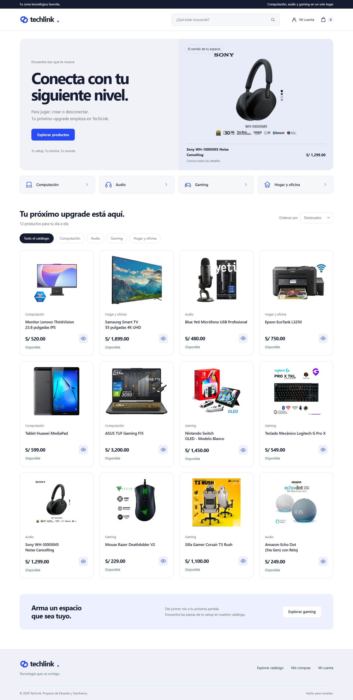
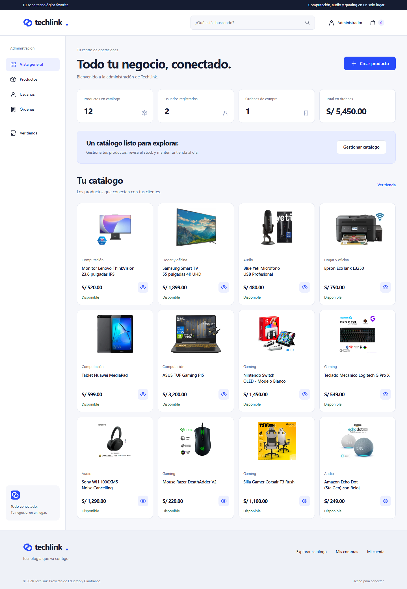
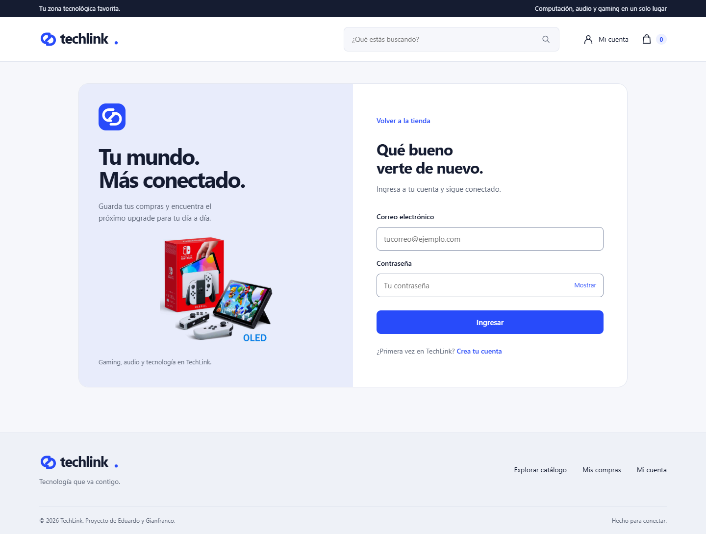
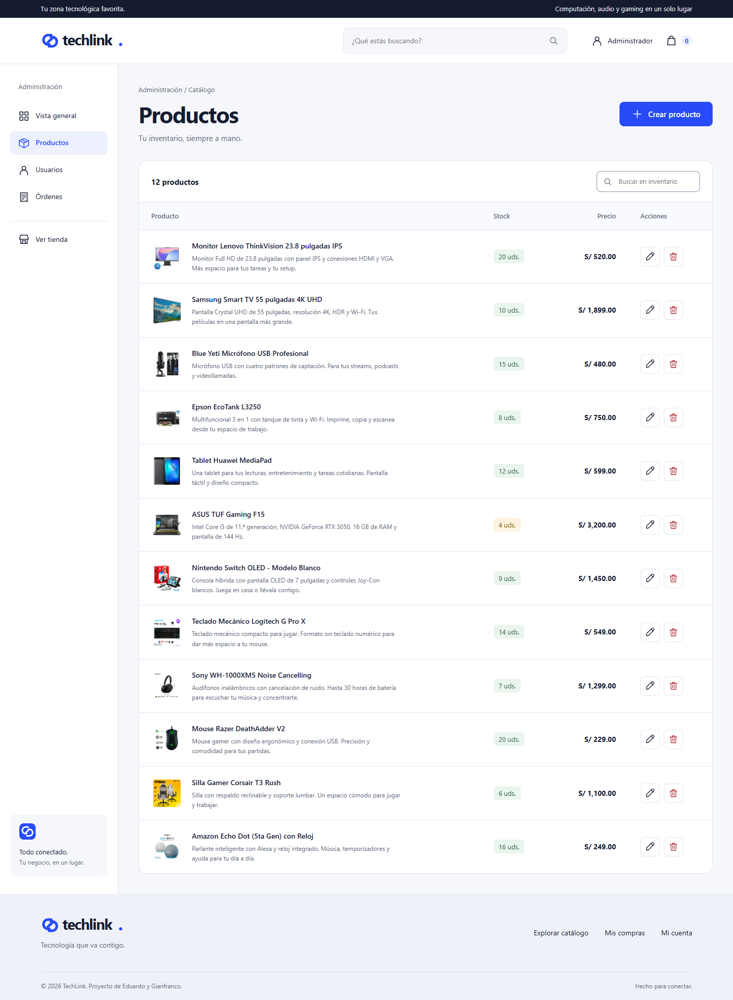
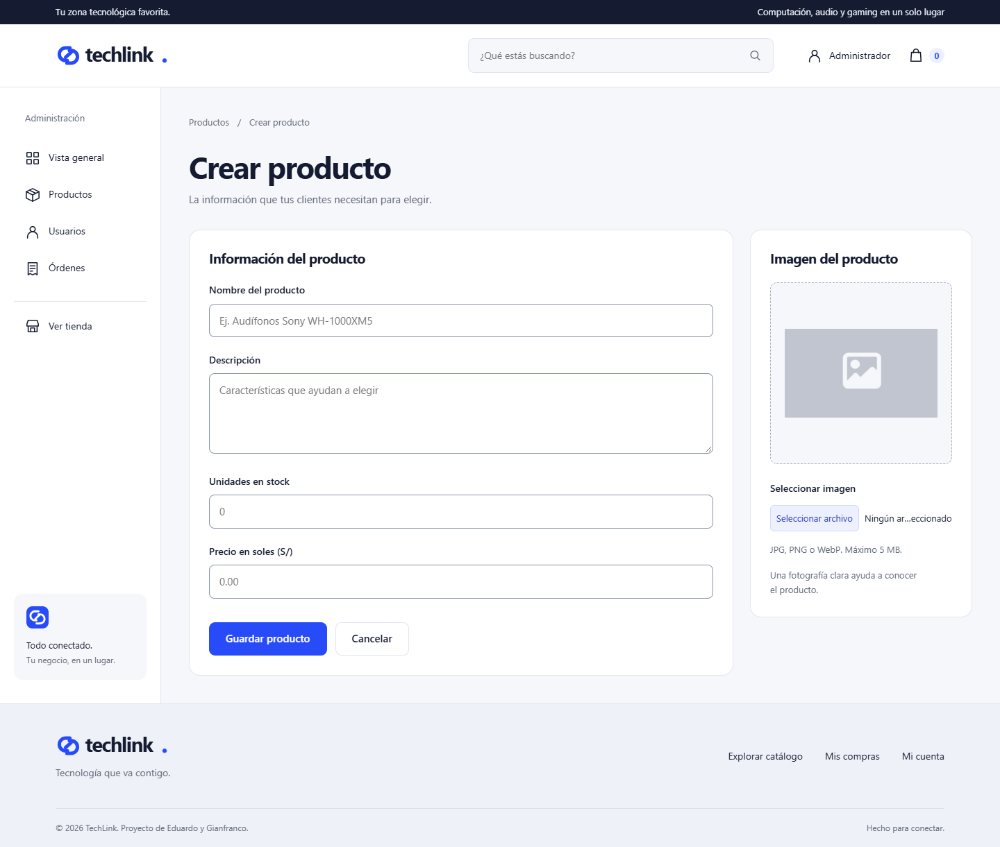
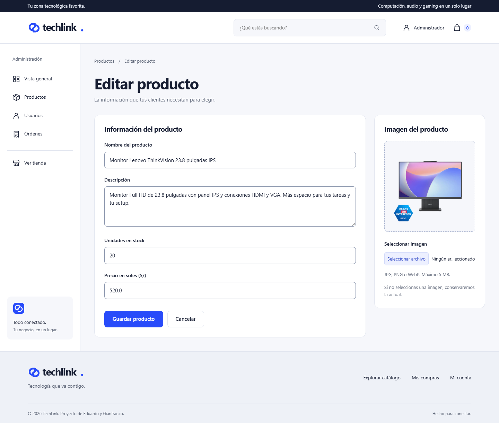
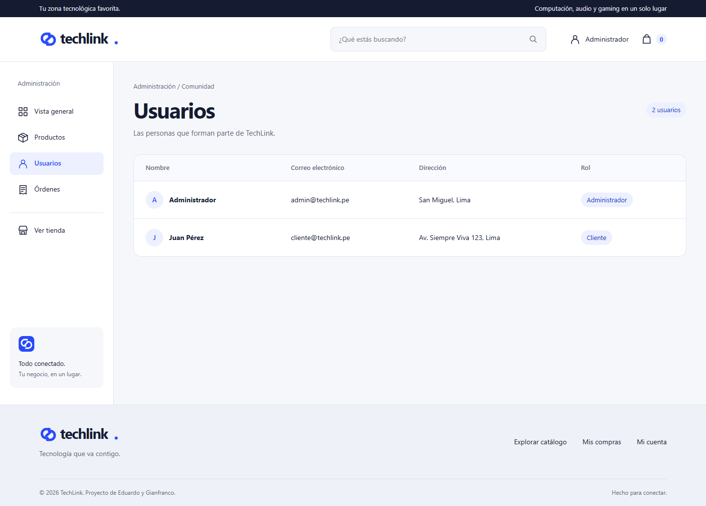
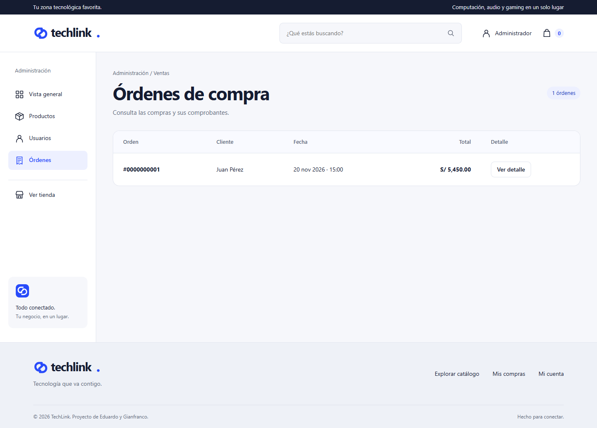
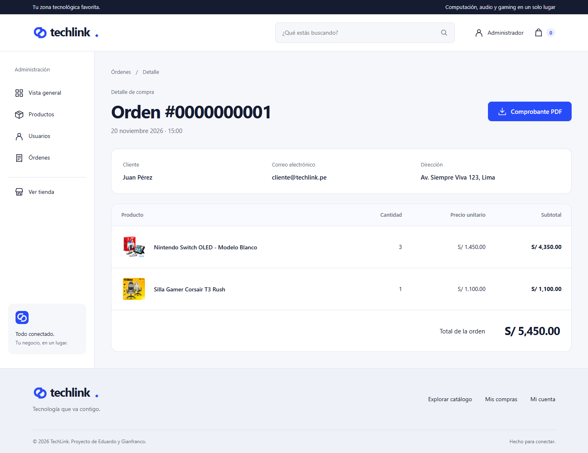

<p align="center">
  <picture>
    <source media="(prefers-color-scheme: dark)" srcset="src/main/resources/static/brand/techlink-white.svg">
    <source media="(prefers-color-scheme: light)" srcset="src/main/resources/static/brand/techlink.svg">
    
  </picture>
</p>

<h1 align="center">Tecnología que va contigo</h1>

<p align="center">
  E-commerce de computación, audio, gaming y hogar.<br>
  Un proyecto de Eduardo y Gianfranco, construido con Java y Spring Boot.
</p>

<p align="center">
  <a href="#galería">Galería</a> ·
  <a href="#ejecución-local">Instalación</a>
</p>

## El proyecto

TechLink conecta un catálogo de productos tecnológicos con el flujo completo de una compra: explorar, elegir, añadir al carrito, revisar el pedido y generar un comprobante PDF. El panel de administración permite gestionar productos y consultar usuarios y órdenes.

Desarrollado como proyecto académico, integra **Spring MVC, Thymeleaf, Spring Security, JPA y JasperReports**. La persistencia local utiliza **SQL Server**.

## Experiencia de compra

La tienda y la administración comparten una identidad visual y una navegación coherente:

- **Identidad propia:** logo vectorial con un símbolo de enlace, azul cobalto y superficies claras.
- **Catálogo:** fotografías del proyecto, categorías, búsqueda, ordenamiento y disponibilidad.
- **Compra:** detalle de producto, carrito, resumen, confirmación e historial con comprobantes PDF.
- **Administración:** navegación común, indicadores del negocio, inventario con filtro y formularios de creación y edición.
- **Diseño adaptable:** vistas revisadas en móvil, tablet y escritorio, con foco visible y controles etiquetados.

Cada sesión mantiene su propio carrito. Las operaciones están protegidas con CSRF y roles, con validaciones de stock y acceso a las órdenes.

## Galería

Capturas de TechLink en ejecución con datos de demostración. Haz clic para verlas completas.

| Tienda | Administración |
| --- | --- |
| [](recursos/tienda-desktop.png) | [](recursos/admin-desktop.png) |

| Inicio de sesión | Versión móvil |
| --- | --- |
| [](recursos/login-desktop.png) | [Vista completa de la tienda en móvil](recursos/tienda-movil.png) |

<details>
<summary>Ver productos, usuarios y órdenes</summary>

| Inventario | Crear producto |
| --- | --- |
| [](recursos/productos-desktop.png) | [](recursos/crear-producto-desktop.png) |

| Editar producto | Usuarios |
| --- | --- |
| [](recursos/editar-producto-desktop.png) | [](recursos/usuarios-desktop.png) |

| Órdenes | Detalle de orden |
| --- | --- |
| [](recursos/ordenes-desktop.png) | [](recursos/detalle-orden-desktop.png) |

</details>

## Funcionalidades

| Tienda y cuenta | Administración |
| --- | --- |
| Buscar, filtrar y ordenar productos | Crear, editar y eliminar productos |
| Consultar precio y disponibilidad | Gestionar fotografías y stock |
| Registrarse e iniciar sesión | Consultar usuarios y sus roles |
| Mantener un carrito por sesión | Revisar órdenes y sus detalles |
| Confirmar una compra y consultar su historial | Abrir los comprobantes PDF |

## Tecnologías

| Capa | Herramientas |
| --- | --- |
| Backend | Java 17, Spring Boot 3.5.6, Spring MVC |
| Seguridad | Spring Security, BCrypt, CSRF y autorización por roles |
| Persistencia | Spring Data JPA, Hibernate y SQL Server |
| Interfaz | Thymeleaf, HTML, CSS y JavaScript nativos |
| Reportes | JasperReports 6.20.0 |
| Pruebas | JUnit 5, MockMvc, Spring Security Test y H2 temporal |
| Construcción | Maven Wrapper |

## Ejecución local

### Requisitos

- JDK 17 o superior y `JAVA_HOME` configurado.
- SQL Server con autenticación mixta, TCP/IP habilitado y puerto accesible.
- `sqlcmd` y una cuenta de Windows con permisos para crear la base y el usuario local.
- PowerShell para los scripts de preparación incluidos.

### Preparar y arrancar

Desde la raíz del repositorio:

```powershell
# Una vez: crear la base TechLink y su usuario local.
powershell -ExecutionPolicy Bypass -File scripts/setup-database.ps1

# Iniciar la aplicación.
powershell -ExecutionPolicy Bypass -File scripts/start-local.ps1
```

Abre [http://localhost:8080](http://localhost:8080/). Para detener el servidor, usa `Ctrl+C`. Ejecuta desde la raíz: las fotografías se sirven desde `images/`.

El script de preparación genera una contraseña SQL local. Hibernate crea las tablas a partir de las entidades. El arranque local habilita una carga de demostración que solo actúa sobre una base completamente vacía: **12 productos, 2 cuentas y 1 orden con 2 detalles**. No restablece usuarios ni modifica datos existentes.

### Accesos locales

Las contraseñas no se publican en este repositorio. Los scripts guardan los datos de acceso en archivos excluidos de Git:

| Archivo local | Uso |
| --- | --- |
| `.local/db-password.txt` | Contraseña de conexión a SQL Server |
| `.local/demo-credentials.json` | Accesos de administrador y cliente de la carga demo |

Consulta el archivo de accesos en tu equipo e ingresa desde [Iniciar sesión](http://localhost:8080/usuario/login). Si la base ya tenía cuentas, la carga inicial conserva sus contraseñas.

### Otra instancia o configuración manual

```powershell
# Sustituye la instancia y el puerto por los de tu instalación.
powershell -ExecutionPolicy Bypass -File scripts/setup-database.ps1 -Server 'localhost\SQL2022'
powershell -ExecutionPolicy Bypass -File scripts/start-local.ps1 -DbHost localhost -DbPort 1433 -Port 8080
```

También puedes definir las variables de entorno y ejecutar `./mvnw.cmd spring-boot:run`:

| Variable | Uso |
| --- | --- |
| `DB_URL` | URL JDBC de SQL Server |
| `DB_USERNAME` | Usuario de conexión |
| `DB_PASSWORD` | Contraseña de conexión |
| `PORT` | Puerto HTTP; por defecto, `8080` |
| `TECHLINK_DEMO_ENABLED` | Activa explícitamente la carga demo; por defecto, `false` |
| `TECHLINK_DEMO_ADMIN_PASSWORD` | Contraseña inicial del administrador demo; mínimo 12 caracteres |
| `TECHLINK_DEMO_CUSTOMER_PASSWORD` | Contraseña inicial del cliente demo; mínimo 12 caracteres |

Las dos contraseñas demo son necesarias para cargar una base vacía si activas la demo sin el script de arranque. La configuración JDBC local confía en el certificado del servidor; adapta la conexión y la gestión de secretos antes de desplegar fuera del entorno de desarrollo.

## Estructura

```text
src/main/java/com/proyecto/ecommerce/
├── config/         # Seguridad, datos demo y modelo compartido de vistas
├── controller/     # Tienda, usuarios, productos y administración
├── model/          # Entidades de usuarios, productos y órdenes
├── repository/     # Acceso a datos con JPA
└── service/        # Servicios, autenticación y archivos
src/main/resources/
├── templates/      # Vistas y fragmentos Thymeleaf
├── static/         # Logo, iconos, estilos y JavaScript
└── reports/        # Plantilla del comprobante PDF
images/             # Fotografías del catálogo
recursos/           # Capturas de la aplicación
scripts/            # Preparación de SQL Server y arranque local
```

## Pruebas y validación

```powershell
./mvnw.cmd test
./mvnw.cmd package
```

Las pruebas utilizan una base H2 temporal en modo SQL Server y credenciales exclusivas de prueba; no alteran la base local. Cubren autenticación, roles, vistas, registro, CSRF, aislamiento del carrito, cantidades, stock, órdenes, privacidad, PDF y CRUD de productos.

La aplicación se comprobó con **9 pruebas automatizadas** y **45 comprobaciones en Chrome**, incluyendo vistas a 375, 768 y 1440 px. Las comprobaciones cubren esas vistas y flujos; no equivalen a una auditoría completa de accesibilidad ni a pruebas en todos los navegadores.

## Identidad visual

- [Logo SVG editable](src/main/resources/static/brand/techlink.svg), [versión con letras blancas](src/main/resources/static/brand/techlink-white.svg) y [símbolo independiente](src/main/resources/static/brand/mark.svg).
- La dirección visual toma como referencia los principios de [Hallmark](https://github.com/Nutlope/hallmark).

## Alcance académico

El catálogo y las órdenes de la carga inicial son datos de demostración. Confirmar una compra guarda la orden y descuenta stock; **no procesa pagos ni cargos**. Los comprobantes PDF son académicos y no tienen validez tributaria.
